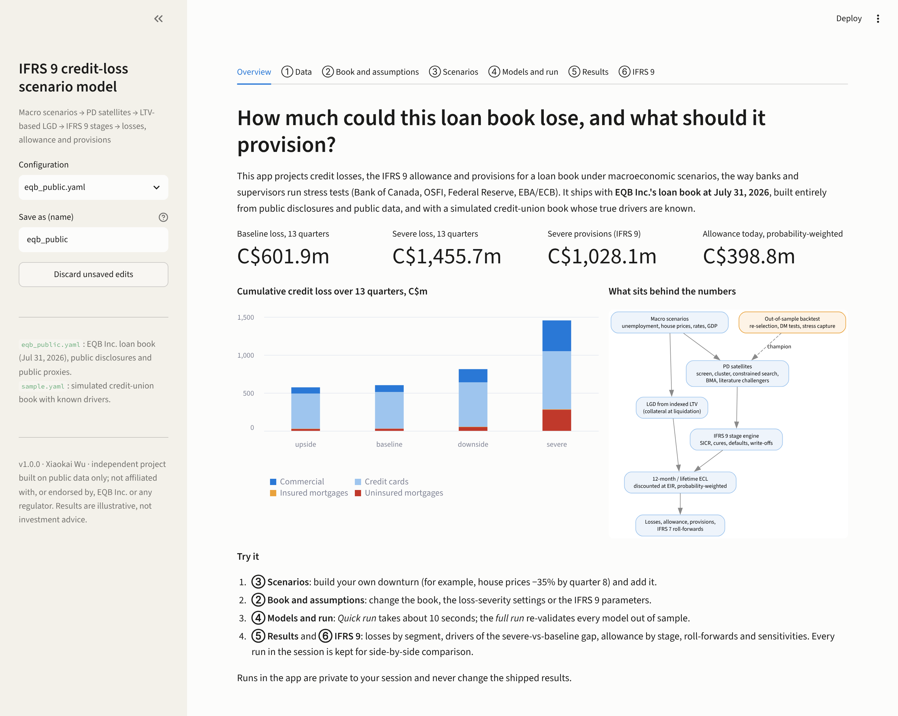
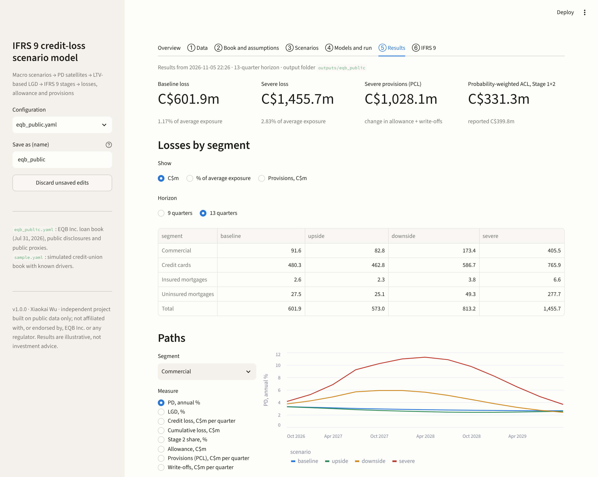
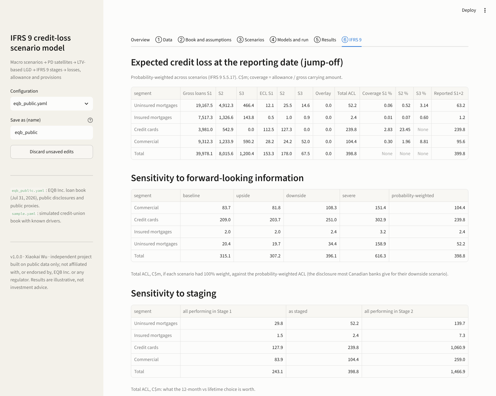

# IFRS 9 Credit-Loss Scenario Model

[](https://github.com/GITHUB_USER/ifrs9-credit-loss-model/actions/workflows/ci.yml)


**How much could a loan book lose in a downturn, and how much should it provision?** This project answers both, the way
banks and supervisors do in stress tests. It turns macroeconomic scenarios into probabilities of default, losses given
default and exposures for each loan segment, and runs them through a full **IFRS 9 expected-credit-loss engine** with
three-stage migration, probability-weighted scenarios and IFRS 7 disclosures. Every PD model is chosen by a
**true out-of-sample backtest** that re-selects drivers at each date.

It ships with two books:
- **EQB Inc.'s loan book at July 31, 2026** (C$49bn of loans), rebuilt **entirely from public disclosures and public data**;
- **a simulated Ontario credit-union book** whose true drivers are known, to show that the selection recovers them.

An interactive **Streamlit app** lets anyone change the book, build a scenario, re-run the model in about 10 seconds
and read the results.



---

## Highlights

- **IFRS 9 end to end:** gross loans tracked by stage every quarter. SICR against origination PD with a 30-days-past-due
  backstop, cures with probation, defaults, write-offs after a workout period. 12-month and lifetime ECL discounted at
  the effective interest rate, probability-weighted across scenarios. Reasonable-and-supportable forecast period with
  reversion. Management overlays. IFRS 7.35H-35I roll-forwards of the allowance and gross loans by stage.
- **Supervisory methods:** PD satellite models from the Bank of Canada (SAP 2026-12, TDSA / TR-128), Federal Reserve
  (CLASS) and ECB/EBA practice, re-estimated as challengers. Mortgage LGD from the indexed LTV at liquidation.
  Static balance sheet. Severe scenario sized like the Bank of England's 2025 test (house prices −30%).
- **Model selection you can defend:** univariate screen → correlation clustering → constrained exhaustive search with
  sign priors and VIF limits, Bayesian model averaging, and literature models. The champion has correct signs, the
  lowest out-of-sample error and a captured GFC stress inside a set band. Diebold-Mariano tests against an AR(1)
  benchmark.
- **Explainable results:** severe-versus-baseline loss split into PD and collateral effects (Shapley) and into macro
  drivers. The same split is shown for each segment, with the severe loss under every admissible PD model as a
  model-risk range.
- **Engineered to be used:** an installable package with a command-line interface, YAML configuration (no names in
  code), cached selection, 25 unit and end-to-end tests in CI, Docker, and a Streamlit app with per-session runs.

## Results: EQB Inc., 13 quarters from July 31, 2026

| C$ millions | Upside | Baseline | Downside | Severe |
|---|---:|---:|---:|---:|
| Uninsured mortgages | 25 | 28 | 49 | 278 |
| Insured mortgages | 2 | 3 | 4 | 7 |
| Credit cards | 463 | 480 | 587 | 766 |
| Commercial + equipment | 83 | 92 | 173 | 406 |
| **Total credit losses** | **573** | **602** | **813** | **1,456** |
| **IFRS 9 provisions (PCL)** | 330 | 358 | 511 | 1,028 |

- **Severe scenario:** unemployment +4.5 pp to about 11%, house prices −30%, policy rate to 0.5%. It adds C$854m of
  losses over baseline: C$706m from higher defaults and C$148m from weaker collateral.
- **Allowance today:** the probability-weighted ACL is C$399m (Stage 1 C$153m, Stage 2 C$178m, Stage 3 C$68m). With 100%
  weight on the severe scenario it would be C$616m. If every performing loan were in Stage 2, it would be C$1.47bn.
- **Reconciliation:** cards are calibrated to EQB's reported allowance. For the other books, the gap to the reported
  figure is shown rather than tuned away; the report explains it.

Full write-up: [`docs/eqb_public_report.html`](docs/eqb_public_report.html) · Method on simulated data:
[`docs/methodology_report.html`](docs/methodology_report.html) · Model documentation: [`docs/MODEL_CARD.md`](docs/MODEL_CARD.md)

<table><tr>
<td></td>
<td></td>
</tr></table>

## Quick start

```bash
git clone https://github.com/GITHUB_USER/ifrs9-credit-loss-model.git
cd ifrs9-credit-loss-model
pip install -e ".[dev]"

creditloss app                                                 # the interactive app (http://localhost:8501)
creditloss run --config config/eqb_public.yaml                 # projection with the validated champions (~10 s)
creditloss run --config config/eqb_public.yaml --backtest --report   # re-validate every PD model, then project
pytest -q                                                      # 25 tests
```

Or with Docker: `docker build -t creditloss . && docker run -p 8501:8501 creditloss`.

**Host it for free on Streamlit Community Cloud:** push the repository to GitHub, open
[share.streamlit.io](https://share.streamlit.io), choose *New app* and point it to `streamlit_app.py`.
`requirements.txt` installs the package. Each visitor's runs go to a private session folder, so the shipped results never
change. Step by step: [`docs/DEPLOY.md`](docs/DEPLOY.md).

| Command | What it does |
|---|---|
| `creditloss run --config C [--backtest] [--report]` | PD selection, scenario losses, IFRS 9 allowance and provisions → `outputs/<config>/` (Excel, charts, `run.pkl`) |
| `creditloss backtest --config C` | Out-of-sample backtest of every PD model with re-selection at each origin |
| `creditloss report --config C` | HTML report from the last run |
| `creditloss build-data` | Rebuild the EQB inputs from the raw public files (reproduces them byte for byte) |
| `creditloss simulate` | Regenerate the simulated credit-union book |
| `creditloss app` | Launch the Streamlit app |

## Methodology

```
macro scenarios ─► PD satellite per segment ─► bank PD path ─┐
      │             (screen → cluster → search, BMA,          ├─► IFRS 9 stage engine ─► ECL, losses, PCL,
      └───────────► LGD from indexed LTV at liquidation ──────┘   (SICR, cures,             IFRS 7 tables
                                                                    defaults, write-offs)
out-of-sample backtest (re-selection at every origin) ─► champion PD model per segment
```

| Step | Module | Precedent |
|---|---|---|
| PD satellite: logit(default rate) on its lag + up to 3 macro drivers | `modelling/pd_satellite.py` | BoC TDSA (TR-128); BoC SAP 2026-12; ECB STAMP€ |
| Screen → cluster → constrained exhaustive search; sign priors; VIF; ranking by dynamic simulation | same | Constrained search as in supervisory satellite models |
| Bayesian model averaging over admissible models | same | Gross & Población (2015), ECB WP 1845 |
| Literature models re-estimated as challengers | same | BoC SAP 2026-12, TDSA, Fed CLASS, ECB/EBA core satellite |
| Bank PD moved with the proxy; or solved so the model allowance equals the reported one | `scenarios/run.py` | EBA constrained bottom-up |
| LGD: indexed LTV at liquidation (perfect foresight), insured, second-lien, Frye-Jacobs, fixed | `modelling/lgd.py` | Fed first-lien model; TDSA; EBA; Frye & Jacobs (2012) |
| Exposure: static, run-off or growth balance sheet; CCF on undrawn limits | `modelling/losses.py` | EBA static balance sheet; Fed 2025 |
| IFRS 9 stage engine, ECL measurement, PCL, roll-forwards | `modelling/ifrs9.py` | IFRS 9 §5.5, B5.5; IFRS 7.35H–35M |
| Out-of-sample backtest, Diebold-Mariano (HLN-corrected), stress capture, champion rule | `validation/` | Fed model-risk principles (SR 11-7); OSFI E-23 |
| Severe-vs-baseline attribution (counterfactual substitution, Shapley) | `scenarios/run.py` | — |
| Top-down net charge-off cross-check | `modelling/nco.py` | Fed CLASS (Hirtle et al. 2016) |

### IFRS 9 alignment

| Requirement | Implementation |
|---|---|
| Three stages; 12-month vs lifetime ECL (5.5.3, 5.5.5) | Gross loans by stage each quarter; Stage 1 over 12 months, Stages 2–3 over the lifetime |
| Significant increase in credit risk vs origination (5.5.9, B5.5.7) | PD above 3× origination PD; borrower PD drift lognormal, calibrated to the reported Stage 2 share |
| 30 days past due backstop (5.5.11) | `dpd30_share`: floor on the Stage 2 share |
| Credit-impaired (Appendix A, B5.5.37) | Stage 3 = defaulted; lifetime ECL with PD = 1 |
| Cures; write-offs (5.4.4) | Stage 2 → 1 after probation; Stage 3 cured to Stage 2 or written off after the workout period |
| Probability-weighted, multiple scenarios (5.5.17(a)) | Four scenarios with configurable weights; sensitivity to 100% weights disclosed |
| Reasonable and supportable information (5.5.17(c), B5.5.13) | Scenario PDs for 12 quarters, then linear reversion to the long-run average over 8 |
| Time value of money (5.5.17(b), B5.5.44) | Expected shortfalls discounted at each segment's effective interest rate |
| Maximum contractual period; revolving exception (5.5.19–20, B5.5.40) | Term to renewal for mortgages; behavioural life and CCF for cards |
| Collateral (B5.5.55) | Mortgage LGD from indexed LTV at sale, net of selling costs and distressed-sale discount |
| Post-model adjustments | Overlays per segment (% or C$) with a written rationale, reported separately |
| Disclosures (IFRS 7.35H–35M) | Allowance and gross-loan roll-forwards by stage, coverage ratios, scenario and staging sensitivity |

### Validation

- **Out-of-sample, honestly:** at every fourth quarter from 2006, the whole selection is re-run on data available at that
  date, and every model forecasts 1–12 quarters ahead.
- **EQB results:**
  - mortgage champion (BoC TDSA-style ARDL): RMSE 0.066 pp against 0.070 pp for AR(1), capturing 124% of the GFC rise;
  - card champion (BMA): RMSE 0.98 pp against 1.91 pp.
- **Simulated book with known drivers:** every champion beats AR(1) by 30–60% and captures 84–148% of the GFC.
  - The data-driven search finds the true unemployment, house-price and mortgage-rate-gap channels for uninsured
    mortgages.
  - The commercial real-estate champion uses two of the three true drivers, at their true lags.
- **Weak spots are disclosed:** for commercial loans no model meets the stress-capture band. The fallback champion
  over-predicts the GFC (336%) and is less accurate than AR(1) in calm periods. It is kept as the conservative choice
  and flagged in [`docs/MODEL_CARD.md`](docs/MODEL_CARD.md).

## Data

- **EQB book:** balances, stage shares, allowances and impaired loans from EQB's Q3 2026 report to shareholders.
- **Loss history (proxies):**
  - Ontario 90+ day mortgage arrears from the Canadian Bankers Association, 1995–2026;
  - US card and business-loan charge-off rates from FRED.
- **Macro history:** OECD and BIS series via FRED.

Sources and treatment: [`data/eqb_public/SOURCES.md`](data/eqb_public/SOURCES.md).

**Your own data:** four CSV files (macro history, macro scenarios, portfolio history, jump-off book) and a YAML
config. Every file and column name lives in the config. You can also upload the files in the app (tab ①), edit the
book (②), build scenarios (③) and save a new configuration.

## Repository layout

```
creditloss/            package
  data/                loading, feature transforms, public-data builder, simulator
  modelling/           PD satellites, LGD, exposure and losses, IFRS 9 engine, NCO check
  scenarios/           end-to-end run, calibration, attribution, IFRS 7 tables
  validation/          backtest, Diebold-Mariano, stress capture, champion rule
  reporting/           charts, Excel workbook, HTML reports
  pipelines/           projection pipeline used by the CLI and the app
  cli.py               `creditloss` command
streamlit_app.py       the app
config/                eqb_public.yaml, sample.yaml, literature / sign-prior tables
data/                  eqb_public/ (public inputs + raw files), sample/ (simulated)
outputs/               shipped results for both configurations
docs/                  reports, model card, screenshots
tests/                 unit and end-to-end tests
```

## Limitations

- **Proxies for loss history:** mortgage default dynamics come from big-bank Ontario arrears, and card and commercial
  dynamics from US charge-offs. EQB's own loss history is not public.
- **Assumptions for undisclosed inputs:** the LTV distribution around the disclosed 69% average, remaining terms,
  workout periods and card limits are assumed and marked as such.
- **Author-built scenarios:** Moody's and supervisory scenarios are not public.
- **One stress episode** for Canadian mortgages since 1996, so out-of-sample tests have little power. Most
  Diebold-Mariano differences are not significant at 5%.

## Disclaimer

Independent project by **Xiaokai Wu**, built only on public information. It is not affiliated with, or endorsed by,
EQB Inc., any regulator or any employer. Results illustrate the method and are not a forecast of any company's results
or investment advice.

MIT licence.
